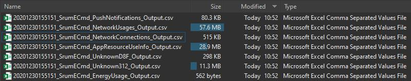

# SrumECmd

A SRUM parser!

## Command Line Interface

    SrumECmd version 2026.10.0

    Author: Eric Zimmerman (saericzimmerman@gmail.com)
    https://github.com/EricZimmerman/Srum

            -d              Directory to recursively process, looking for SRUDB.dat and SOFTWARE hive. This mode is primarily used with KAPE so both SRUDB.dat and SOFTWARE hive can be located
            -f              SRUDB.dat file to process. Either this or -d is required
            -r              SOFTWARE hive to process. This is optional, but recommended

            --csv           Directory to save CSV formatted results to. Be sure to include the full path in double quotes

            --dt            The custom date/time format to use when displaying time stamps. Default is: yyyy-MM-dd HH:mm:ss
            --temp          Folder for the temporary copy of the SRUM database and its transaction logs, which is opened instead of the evidence and deleted when done. Default: a Temp folder next to SrumECmd. A folder that isn't there is created, and removed again when done. If that folder can't be written to, SrumECmd stops: give a writable folder with --temp

            --debug         Show debug information during processing
            --trace         Show trace information during processing

    Examples: SrumECmd.exe -f "C:\Temp\SRUDB.dat" -r "C:\Temp\SOFTWARE" --csv "C:\Temp\"
              SrumECmd.exe -f "C:\Temp\SRUDB.dat" --csv "c:\temp"
              SrumECmd.exe -d "C:\Temp" --csv "c:\temp"

              Short options (single letter) are prefixed with a single dash. Long commands are prefixed with two dashes

Exit codes: 0 on success; 1 for invalid arguments, a database that can't be read, or an export that failed.

Windows only (the database is read with Windows' ESE engine, `esent.dll`).

## Output

One CSV per provider table: `AppResourceUseInfo`, `AppTimelineProvider`, `EnergyUsage`, `NetworkConnections`, `NetworkUsages`, `PushNotifications` and `vfuprov`, always written. Since 2026.10.0:

- `AppTimelineProvider` has the seconds in focus, in the foreground, with user, keyboard and mouse input, with the display required and with audio in and out (`InFocusS`, `PsmForegroundS`, `UserInputS`, `KeyboardInputS`, `MouseInputS`, `DisplayRequiredS`, `AudioInS`, `AudioOutS`), after the existing columns.
- The tables seen on Server 2022 are exported when they have rows: `ProcessorTime`, `SizeInBytes`, `TotalUsed` and `NetworkBytes`. What they measure is in `ExeInfo` (for example `Total`, a volume, a network adapter).
- `--dt` applies to the `Timestamp` columns too.

## Dirty databases

`SRUDB.dat` is never opened where it is: SrumECmd copies it, with its transaction logs (`SRU*.log`, `SRU.chk`, `*.jrs`), to a temporary folder and works on the copy. Nothing next to `SRUDB.dat` changes, so it can be read-only. The temporary folder is `--temp`, or by default a `Temp` folder next to SrumECmd (never the user's `%TEMP%`); the copy is deleted when done. If that folder can't be written to, SrumECmd stops and asks for `--temp`.

A `SRUDB.dat` collected from a running system is usually dirty. SrumECmd handles this by itself, on the copy:

1. The transaction logs, when they were collected, are replayed into the copy (what `esentutl.exe /r sru /i` did by hand; the old way could also fail with "Access denied", as the logs name the live database's path).
2. A copy that is still dirty (its logs are missing) is repaired with `esentutl.exe /p`. What only the missing logs had is lost; SrumECmd says when this was done.

There is no need to repair anything by hand any more. `esentutl.exe /mh SRUDB.dat` shows a database's state.

Examine the output in Timeline Explorer!

# Download Eric Zimmerman's Tools

All of Eric Zimmerman's tools can be downloaded [here](https://ericzimmerman.github.io/#!index.md). 

# Special Thanks

Open Source Development funding and support provided by the following contributors: 
- [SANS Institute](http://sans.org/) and [SANS DFIR](http://dfir.sans.org/).
- [Tines](https://www.tines.com/?utm_source=oss&utm_medium=sponsorship&utm_campaign=ericzimmerman)
